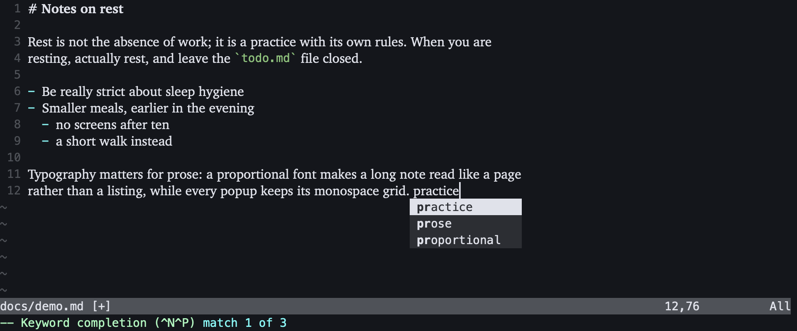

# NuiVim

A small macOS app that runs Neovim and sets prose in a proportional font, while
every floating window (completion menus, LSP hovers, Telescope and other plugin
popups) keeps its exact monospace layout.

It works with your normal Neovim config, or none at all, and never changes it.



## How it works

Neovim's UI protocol (`ext_multigrid`) sends every window and every float as its
own grid of cells. NuiVim lays out all grids on an imaginary monospace cell
grid, so windows and floats land where Neovim and plugins expect them, and then
draws only the text area of prose windows in a proportional font inside its
window box. Line numbers, signs, statuslines, the command line and all floats
stay monospace. Floats attached to text (completion, hover, signature help) are
moved to where that text actually is.

## Install

You need macOS 11 or newer and **Neovim 0.10 or newer** (`brew install neovim`).
NuiVim finds `nvim` on the `PATH` of your login shell; set `NUIVIM_NVIM` to
use another binary.

Build from source (Rust, Node 20 and the Xcode command line tools):

```sh
npm ci
npm run tauri build                     # .app and .dmg for this Mac
scripts/build-universal.sh              # universal (Apple Silicon + Intel) .app and .dmg
```

The universal build needs a Rust toolchain with both macOS targets. If yours
lacks the Intel one (Homebrew's Rust does), install a private toolchain into the
project folder, which the script then uses:

```sh
RUSTUP_HOME=$PWD/.toolchain/rustup CARGO_HOME=$PWD/.toolchain/cargo \
  rustup toolchain install stable --profile minimal \
  --target x86_64-apple-darwin --target aarch64-apple-darwin
```

The bundles land in `src-tauri/target/.../release/bundle/`. The app is not
signed: the first time, right-click it in Finder and choose **Open**, or run
`xattr -dr com.apple.quarantine NuiVim.app`.

Open files by dropping them on the window (they open in the current tab), with
**Open With** in Finder (a new tab), or from a terminal with the `nuivim`
command (below).

### The `nuivim` shell command

Choose **NuiVim → Install Shell Command…** once. It writes a small script to
`~/.local/bin/nuivim` (add `~/.local/bin` to your `PATH` if it is not there).
Then, from any terminal:

```sh
nuivim notes.md          # a new tab for notes.md, working directory = this directory
nuivim                   # a new tab in this directory
```

If NuiVim is running, the files open in a new tab of that window; otherwise
NuiVim starts. The tab's Neovim runs in the directory you ran the command from,
so relative paths, `:e`, file pickers and `:pwd` behave as in a terminal.

## Tabs

Each tab is its own Neovim, with its own working directory, buffers and
`:messages`; closing the tab (or quitting its Neovim with `:q`) ends it.

| Key | |
| --- | --- |
| **Cmd-T** | new tab: Neovim's start screen in the working directory from Settings |
| **Cmd-W** | close tab (`:confirm qa` in that tab, so unsaved changes are asked about) |
| **Cmd-1** … **Cmd-8**, **Cmd-9** | go to tab 1–8, the last tab |
| **Cmd-Shift-]**, **Cmd-Shift-[** | next, previous tab |

The tab bar hides itself while only one tab is open; turn that off in Settings.
A tab's title is the name of the file in its current window.

## Settings

**NuiVim → Settings…** (**Cmd-,**):

- **Working directory**: where new tabs start (default: your home folder). Tabs
  opened with the `nuivim` command start where it was run instead.
- **Homepage file**: opened in the first tab when NuiVim starts with nothing
  else to open, e.g. `~/notes/index.md` or a path relative to the working
  directory. Later tabs start empty, so two Neovims never hold the same file
  (and its swap file).
- **Hide the tab bar when only one tab is open.**
- **Appearance**: the same options as `vim.g.nuivim` below. Each field shows
  the value in use (the mono font and size come from `'guifont'`, the spacing
  from `'linespace'`); only values you change are stored. A value set in
  `vim.g.nuivim` wins over the one in Settings; the Settings window shows such
  fields greyed out, with the `vim.g.nuivim` value.

Settings are stored in `~/Library/Application Support/app.nuivim/settings.json`.

## Configuration

Besides the Settings window, NuiVim can be configured from your Neovim config with one global table. It is harmless
in a terminal Neovim, so one `init.lua` works everywhere:

```lua
vim.g.nuivim = {
  prose_font = "Charter",          -- CSS font family: any installed font
  prose_size = 17,                 -- points
  mono_font = "JetBrains Mono",    -- overrides 'guifont' when set
  mono_size = 14,
  prose_filetypes = { "markdown", "text", "tex", "gitcommit", "mail" },
  mono_hl_groups = { "@markup.raw", "markdownCode", "texMathZone" },
  overflow = "shrink",             -- or "clip"
  option_is_meta = "none",         -- "none" | "left" | "right" | "both"
  linespace = 6,                   -- extra pixels between rows, nuivim only
}
```

| Key | Type | Default |
| --- | --- | --- |
| `prose_font` | string | Charter |
| `prose_size` | number, points | 16 |
| `mono_font` | string | from `'guifont'`, else Menlo |
| `mono_size` | number, points | from `'guifont'` (`Name:h14`), else 14 |
| `prose_filetypes` | list of filetypes | markdown, text, tex, plaintex, rst, org, norg, typst, asciidoc, gitcommit, mail |
| `mono_hl_groups` | list of highlight groups | @markup.raw, @markup.raw.block, @markup.math, markdownCode, markdownCodeBlock, texMathZone |
| `overflow` | `"shrink"` or `"clip"` | shrink |
| `option_is_meta` | `"none"`, `"left"`, `"right"`, `"both"` | none |
| `linespace` | whole pixels, 0–100 | Neovim's `'linespace'` option (0) |

- Change the table and run `:NuivimReload` to apply it without restarting.
- An unknown key or a wrong value is ignored (the default stays) and shows one
  warning, e.g. `nuivim: overflow must be "shrink" or "clip"`.
- `prose_filetypes`: windows showing these filetypes (and not terminals) get
  proportional text. So do floating windows that show a file with one of these
  filetypes, such as a zen or reading page; popups (LSP hover, completion docs,
  pickers) show scratch buffers and stay monospace even when they hold Markdown. Everything else stays monospace, including plugin windows
  such as file trees and dashboards, which have their own filetypes.
- In prose windows, leading indentation and one list marker with its space
  (`- `, `* `, `1. `, `•`, `○`) keep their monospace widths, so nested lists,
  wrapped lines (`breakindent`) and plugin indentation (orgmode's virtual
  indent) line up as in a terminal; the text after them is proportional.
- `mono_hl_groups`: text in these highlight groups (inline code, math) is set in
  the mono font but stays in the flow of the line. A group also matches its
  dotted children (`@markup.raw` matches `@markup.raw.markdown_inline`).
- `overflow`: what happens when a line set in the prose font is wider than its
  window, which is rare: `shrink` narrows that line to fit, `clip` cuts it off.
- `linespace`: extra pixels between rows, for every row (prose and mono alike).
  Unlike Neovim's `'linespace'` option, which other GUIs such as Neovide also
  read, it only affects NuiVim.
- `option_is_meta`: which Option key sends `<M-…>`. Otherwise Option types its
  character as usual (`å`, `…`).

### Telling a NuiVim session apart

Inside NuiVim, `vim.g.nuivim_ui` is `1`. It is set right after startup, so
`init.lua` cannot see it yet, but anything evaluated later can (decoration
providers, autocmds after `VimEnter`, keymaps):

```lua
if vim.g.nuivim_ui then ... end
```

### Wrapping prose

Neovim still wraps lines by character count, so proportional lines end a little
short of the right edge. For prose, wrap at word boundaries:

```lua
vim.api.nvim_create_autocmd("FileType", {
  pattern = { "markdown", "text", "tex" },
  command = "setlocal wrap linebreak breakindent",
})
```

### Keys

- **Cmd-=**, **Cmd--**, **Cmd-0**: bigger, smaller and configured font sizes
  (both fonts, this session only).
- **Cmd-Q** and the close button run `:confirm qa` in every tab. **Cmd-H**
  hides, **Cmd-M** minimises, **Cmd-,** opens Settings; **Cmd-T**, **Cmd-W**,
  **Cmd-1…9** and **Cmd-Shift-[ / ]** are for tabs.
- Every other Cmd combination reaches Neovim as `<D-…>`. NuiVim maps
  **Cmd-C** (copy in visual mode), **Cmd-V** (paste in normal, insert and
  command-line mode) and **Cmd-A** (select all), but only where you have not
  mapped those keys yourself.
- The clipboard is Neovim's own (`"+`, through `pbcopy`/`pbpaste`).

## Known limits

- Wrapped prose lines end short of the right edge (see above).
- Text that relies on alignment inside a prose window, such as Markdown tables
  and ASCII diagrams, does not line up. Put it in a code block or a filetype that
  is not in `prose_filetypes`.
- `mono_hl_groups` matches the highlight group that actually holds the colours.
  Neovim's default colorscheme leaves `@markup.raw` undefined, so inline code
  falls back to `Special` and stays proportional; most colorschemes define
  `@markup.raw` and work as expected.
- In prose windows, cells past the end of the text are one space wide each, so
  things drawn there (`colorcolumn`, virtual text at a fixed column) do not land
  at their monospace position. Trailing highlights such as `CursorLine` and
  visual selection still stretch to the window edge.
- With Option as Meta, keys other than letters and digits send the character
  Option produces.
- `winblend`/`pumblend` transparency, ligature settings, smooth scrolling and
  cursor animation are not supported.
- One window; each tab runs one local Neovim. Neovim draws its own command
  line, messages, popup menu and tabline (`:tabnew` tabs live inside a NuiVim tab).

## Development

```sh
npm run tauri dev        # the app, with live reload of the frontend
npm test                 # lint, types, unit (Vitest, cargo test), end-to-end (Playwright WebKit)
npx tsx tests/fixtures/record.ts   # re-record redraw fixtures after a Neovim upgrade
```

The end-to-end tests run the frontend in Playwright's WebKit (the engine behind
WKWebView) against `tests/e2e/harness.ts`, which gives each test its own
`nvim --embed --clean -u tests/fixtures/init.lua`. Screenshots of the main
scenarios are saved to `tests/e2e/screenshots/`.

Code map:

- `src-tauri/src/` — Rust backend: one Neovim per tab (`nvim.rs`), launch
  arguments and the shell command script (`launch.rs`), the login-shell
  environment (`shellenv.rs`), app window, menu, settings file and commands
  (`main.rs`), and the Lua bridge run inside each Neovim (`bridge.lua`).
- `src/main.ts` — the app: tabs, tab bar, settings, keyboard. `src/session.ts` —
  one tab: its Neovim's state, renderer and screen.
- `src/model/` — UI state from redraw events: grids, highlights, windows,
  cursor, keys, layout math, the tab list. No DOM, enforced by ESLint.
- `src/settings.ts`, `src/config.ts` — settings and `vim.g.nuivim`, and how they combine.
- `src/view/` — turns the model into DOM: rows, prose runs, floats, cursor,
  tab bar, Settings window.
- `src/input/` — keyboard, IME and mouse.
- `src/transport.ts` — Tauri events and commands in the app, a WebSocket in tests.

Decisions the build spec left open are recorded in [DECISIONS.md](DECISIONS.md).
